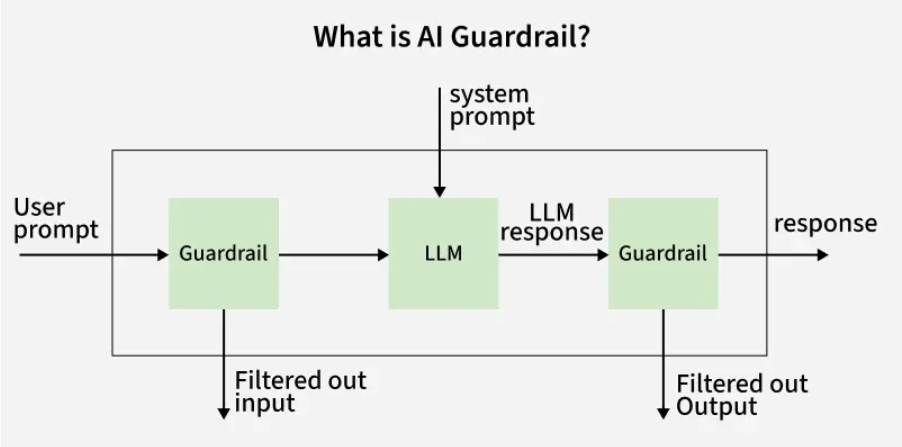

# Agent Systems

Agent systems allow AI models to perform complex tasks by planning and executing multiple steps. Instead of generating a single response, these systems can break down a task, use tools and complete workflows automatically.
These systems include components such as:

## Planners

It involves planning task steps and selecting appropriate tools like APIs, databases, or search systems to complete the task.
There are 4 types of planning:

### Classical planning

Assumes a fully observable and deterministic environment where the AI agent has complete knowledge of the system and follows a fixed sequence of actions to achieve a goal.

- Forward State Space Planning (FSSP): Starts from the initial state and explores actions step-by-step toward the goal.
- Backward State Space Planning (BSSP): Begins from the goal state and works backward toward the initial state.

Classical planning has 2 main categories:

- State-space search explores the space of all possible states by applying actions step-by-step until the goal is reached.
- Plan-space search starts with a partial plan and incrementally refines it until it’s complete and consistent. This approach is useful for problems with complex dependencies between actions.

### Probabilistic Planning

Handles environments with uncertainty where some actions might have unpredictable outcomes. Example: Autonomous vehicles navigating traffic where road conditions and other drivers' behaviors are uncertain.

### Reactive Planning

Focuses on dynamic, real-time responses rather than fixed plans. The AI agent continuously senses its environment and acts based on the latest information, ideal for rapidly changing situations. Example: A robot avoiding obstacles in an unknown environment or video game AI adapting to player actions.

### Hierarchical Task Network (HTN) Planning

Breaks complex tasks into smaller sub-tasks and creates plans for each step. This approach simplifies large-scale problem solving where goals can be divided into manageable steps. Example: A robot assembling a product by breaking the task into subtasks like gathering parts, assembling and testing the product.

## Memory Systems

Store previous interactions or important information so the system can maintain context across tasks.
AI agents use different types of memory, each serving a unique purpose:

- Short-term memory (STM) is like the AI agent’s temporary notepad. It holds recent information just long enough to finish the current task. After that, it is cleared for the next job. This type of memory is great for quick tasks such as customer support chats, where the agent only needs to remember the ongoing conversation to help the user.
- Long-term memory (LTM) stores information for much longer periods. It can keep specific details, general facts, instructions or even the steps needed to solve certain problems. There are different types of long-term memory:
  - Episodic Memory: This type remembers specific events from the past like a user’s date of birth that was used during an earlier conversation. The agent can use this memory as context in future interactions. Example: Stores specific events and experiences, for example the sequence of actions taken in a mission.
  - Semantic Memory: This holds general knowledge about the world or things the AI has learned through past interactions. The agent can refer to this information to handle new problems effectively. Example: Stores facts and world knowledge, for example Paris is the capital of France.
  - Procedural Memory: Here the agent stores “how-to” steps or rules for making decisions. For example, it might remember the process for solving a math problem and use the same steps when tackling a similar task later. Example: Stores rule based data for immediate tasks, for example numbers held while solving a math problem.

### Storage Methods and Techniques

Memory can be implemented in various ways depending on the type and scale required:

- Buffers and queues: Simple for short-term storage.
- Databases: Structured for long-term and reliable storage.
- Vector databases: Store text embeddings i.e data is converted in numeric form for semantic search.
- Knowledge graphs: Organize facts and relationships via graph.
- Neural memory modules: Integrate memory into neural networks.

## Guardrails

Apply safety rules to prevent harmful outputs or unsafe actions.
Their primary function is to intercept, block and mitigate risks in real time. It protects organizations from issues like:

- Hallucinations: When the model generates incorrect or fabricated information.
- Data leakage: Exposure of sensitive or private information through model outputs.
- Prompt injections: Malicious inputs designed to manipulate the model’s behaviour.

