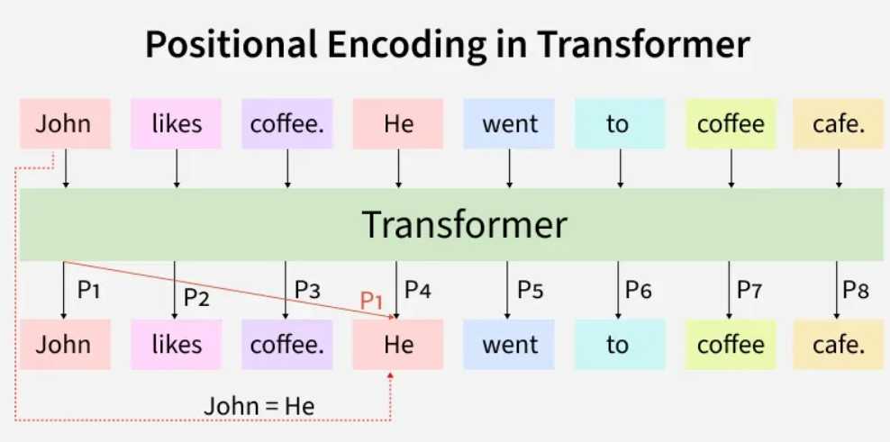

# LLM Architecture

Large Language Models (LLMs) are based mainly on transformer architectures which allow efficient learning of relationships between words in a sequence.

## Input Layer: Tokenization

Input text is broken into tokens which are smaller units like words, subwords or characters.
Tokens are converted into numerical representations that the model can process.

## Embedding Layer

Word embeddings map tokens to dense vectors representing their meanings.
Positional embeddings are added to indicate the order of tokens, since transformers cannot process sequences in order naturally.

### Positional embeddings

Positional encoding is a technique that adds information about the position of each token in a sequence to its input embedding. This helps transformers understand the order of tokens and capture the structure of a sequence. Without positional information, the self-attention mechanism alone does not inherently know the order of the tokens.

## Transformer Architecture

Transformer architecture uses attention to process an entire sentence at once instead of reading words sequentially.
Core Concepts of Transformers:

### Self attention mechanism

It allows transformers to determine which words in a sentence are most relevant to each other. This is done using a scaled dot-product attention approach.
Each word in a sequence is mapped to three vectors:

- Query (Q)
- Key (K)
- Value (V)

### Multi-head attention

Instead of one attention mechanism, transformers use multiple attention heads running in parallel. Each head captures different relationships or patterns in the data, enriching the model’s understanding.

### Positional Encoding

Unlike RNNs, transformers lack an inherent understanding of word order since they process data in parallel. To solve this problem Positional Encodings are added to token embeddings providing information about the position of each token within a sequence.

### Position-wise Feed-Forward Networks

### Add & Norm (Residual Connections and Layer Normalization)

### Embeddings

Transformers cannot work with raw words as they need numbers. So, each input token (word or subword) is converted into a vector, called an embedding.

### Encoder-Decoder Architecture

The encoder-decoder structure is key to transformer models. The encoder processes the input sequence into a vector, while the decoder converts this vector back into a sequence. Each encoder and decoder layer includes self-attention and feed-forward layers.

### Softmax Layer for Output Prediction

## Stacking Layers

Transformers are composed of multiple blocks stacked together.
Each block contains attention and feedforward layers to capture complex relationships and hierarchical patterns in text.

## Output Layer: Decoding

In autoregressive models like GPT, the model predicts the next word in a sequence.
In masked models like BERT, the model predicts missing words in a sequence.
The final softmax layer converts outputs into probability distributions over the vocabulary.
