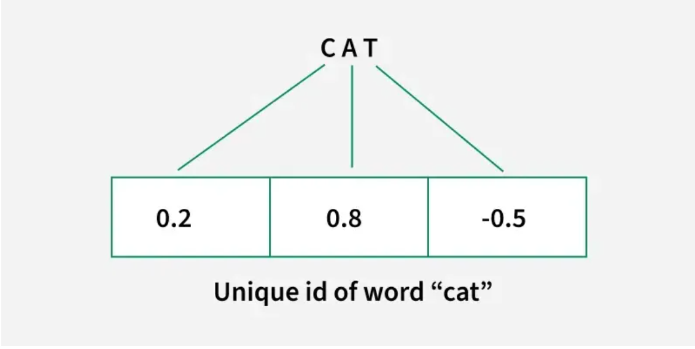

# Embeddings

## Working

### Input Representation

Suppose we have a sentence containing words such as "cat", "dog" and "apple". Each word is assigned a unique integer ID based on the vocabulary.

### Embedding Mapping

The embedding layer maps each word ID to a dense numerical vector. Instead of representing "cat" as a single number, it represents it as a vector such as [0.2, 0.8, -0.5]. Similarly, "dog" could be represented as [0.3, 0.7, -0.6]. The values in these vectors are learned during model training.

### Learning Relationships

During training, the model updates the embedding vectors based on the training objective. Words that occur in similar contexts may develop similar vector representations, allowing the model to capture useful relationships between words.

### Example of Learning Relationships

- Consider the sentence "The cat chased the mouse."
- Across many training examples, the model learns from the contexts in which words such as "cat", "dog" and "mouse" appear.
- If "cat" and "dog" occur in similar contexts, their embedding vectors may become more similar, allowing the model to capture relationships between them in the embedding space.

## T-distributed Stochastic Neighbor Embedding (t-SNE) Algorithm - ML

T-distributed Stochastic Neighbor Embedding (t-SNE) is a non linear dimensionality reduction technique used for visualizing high-dimensional data in a lower-dimensional space mainly in 2D or 3D. Unlike linear methods such as Principal Component Analysis (PCA), t-SNE focus on preserving the local structure and pattern of the data.

- Dimensionality reduction is a process that simplifies complex dataset by combining similar or correlated features.
- It helps in improving analysis and computational efficiency.
- t-SNE works by looking at the similarity between data points in the high-dimensional space.
- The similarity is computed as a conditional probability. It calculates how likely it is that one data point would be near another.
