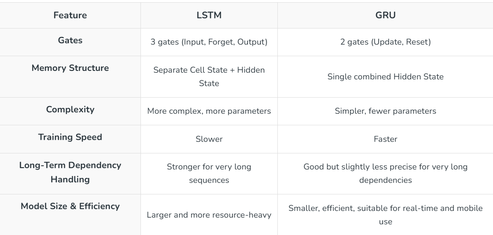

# Long Short-Term Memory (LSTM)

LSTM networks are a special type of recurrent neural network designed to learn from sequence data while overcoming the limitations of traditional RNNs. With their unique memory‑cell structure, LSTMs can remember information over long time intervals, making them highly effective for tasks involving patterns across time.

Handles long‑term dependencies without vanishing gradients
Uses gates to control how information is stored and forgotten
Widely used in NLP, time‑series forecasting and speech processing
Performs well on sequential and temporal prediction problems

## Working of LSTM

### Decide What to Forget (Forget Gate)

- The forget gate takes the previous hidden state and the current input.
- It produces values between 0 and 1 using a sigmoid activation.
- These values determine how much of the previous cell state should be kept.
- Values near 1 mean the information is retained.
- Values near 0 mean the information is discarded
- This mechanism helps remove outdated or irrelevant context from long sequences.

### Decide What New Information to Add (Input Gate + Candidate Memory)

- The input gate determines how much of the new information should be written into the memory.
- The candidate memory creates a new vector of potential information using a tanh activation.
- The input gate filters the candidate memory before it is added to the cell state.
- This ensures that only relevant new information updates the internal memory.

### Update the Cell State (Memory Highway)

- The updated cell state is formed by combining the scaled previous memory and the filtered new memory.
- The forget gate reduces or removes parts of the old memory.
- The input gate and candidate memory add new information to fill in or modify the cell state.
- Additive updates help gradients flow more consistently, preventing the vanishing gradient problem.
- This stable memory path enables learning complex long-range patterns.

### Generate the Output (Output Gate)

- The output gate determines how much of the updated cell state influences the hidden state.
- A sigmoid activation computes this output filter.
- The filtered value is merged with the tanh-transformed cell state to produce the final hidden state.
- The hidden state serves as the LSTM’s output at time step t.
- The same hidden state is passed forward to the next time step for continued processing.

## Types of LSTM

### Vanilla LSTM (Standard LSTM)

This is the basic version of the LSTM architecture containing a single LSTM layer.
It processes the input sequence step-by-step using its memory cell and gating system.
It is suitable for tasks where patterns are not overly complex or hierarchical.
It serves as the foundation for more advanced LSTM architectures.

### Stacked LSTM (Deep LSTM)

Multiple LSTM layers are placed on top of each other, allowing deeper sequence representation learning.
Lower layers learn simple temporal patterns, while higher layers capture more abstract relationships.
This architecture is helpful when the task involves complex dependencies across multiple sequence levels.
It is commonly used in deep learning tasks such as speech modeling and advanced NLP problems.

### Bidirectional LSTM (BiLSTM)

The sequence is processed in both forward and backward directions.
This allows the model to understand both past and future context for each time step.
It improves performance in tasks where understanding full surrounding context is important such as sentiment analysis and named entity recognition.
It is especially useful in text-based tasks where each word’s meaning depends on both previous and next words.

### Peephole LSTM

Gates are allowed to directly access the cell state, improving timing precision.
This variation enhances performance in tasks that require fine control of memory updates, such as modeling periodic or time-sensitive patterns.
It gives the model more visibility into the internal memory dynamics during gate decisions.

### CNN–LSTM Hybrid

Convolutional layers handle spatial feature extraction, while LSTMs capture temporal dynamics.
This combination is useful for sequential image tasks, video analysis and sensor signal recognition.
CNN layers reduce input dimensionality, allowing LSTMs to focus on temporal relationships more efficiently.

### Encoder–Decoder LSTM

One LSTM acts as an encoder to compress the sequence into a fixed representation.
Another LSTM acts as a decoder to generate the output sequence.
This structure is used in tasks like machine translation, text summarization and sequence generation.
It was the main architecture for seq-to-seq models before attention and transformer mechanisms became popular.

### Attention-LSTM Models

Attention mechanisms are added to allow the model to focus on specific parts of the input sequence during decoding.
This significantly improves performance by highlighting important steps rather than treating all equally.
It is widely used in translation, text generation and speech tasks before full Transformer models took over.

## LSTM vs GRU

