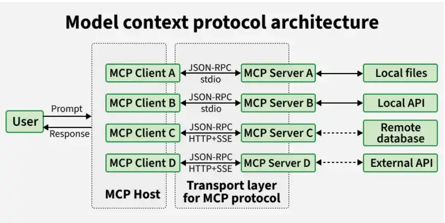

# Model Context Protocol (MCP)

Model Context Protocol (MCP) is a standardized framework by Anthropic that enables AI models to connect with external tools and data sources, providing secure, scalable and real time access without custom integrations.

## Architecture

MCP is designed as a flexible system that connects AI models with external tools and data sources through three main components: servers, clients and hosts, enabling smooth and efficient interaction.

### MCP Hosts

Provide the interface where users interact with the AI system.
Coordinate communication between multiple clients and servers.
Manage workflows and ensure smooth execution of requests.
Handle orchestration logic for end to end task processing.

### MCP Clients

Act as a communication bridge between the host and server.
Convert user requests into structured protocol messages for processing.
Maintain a 1:1 connection with servers while a host can have multiple clients.
Manage sessions including timeouts, interruptions and reconnections.
Handle responses, errors and ensure outputs remain contextually relevant.

### MCP Servers

Handle data access and actions by connecting to databases, APIs or tools.
Process requests and return results based on client queries.
Provide resources (data), tools (actions) and prompts (structured workflows).
Integrate with services like GitHub, Slack and cloud platforms.

## Communication Mechanism

MCP supports two primary transport layers for communication:

- STDIO (Standard Input/Output): Ideal for local execution where the client spawns the server as a child process and communicates via standard I/O streams.
- SSE (Server-Sent Events) over HTTP: Designed for remote, distributed architectures where the server is hosted in the cloud.
