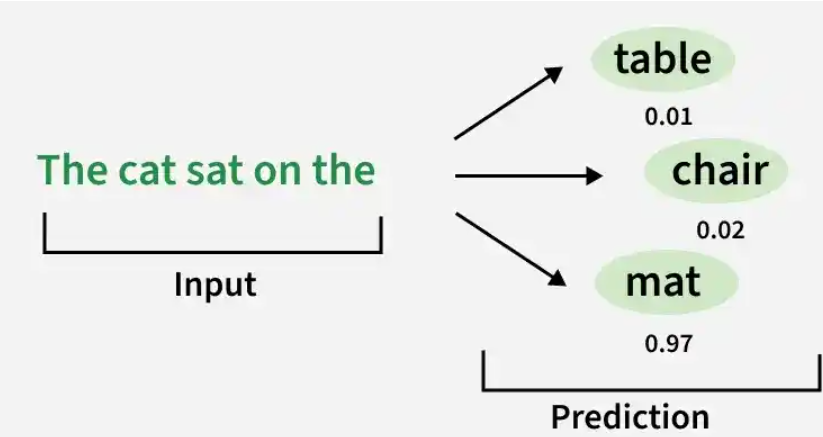

# LLM

## Working of LLM

### Tokenization

The input text is divided into smaller units called tokens.
For example, "Machine learning is useful __" may be split into: ["Machine", " learning", " is", " useful"]

### Embeddings

Each token is converted into a numerical vector called an embedding, which represents its meaning and relationships with other tokens.

### Transformer Architecture

The tokens pass through multiple Transformer blocks that process their relationships using self-attention and feed-forward networks.
A simplified flow is: Tokens → Embeddings → Transformer Blocks → Output

### Self-Attention

Self-attention helps the model understand relationships between tokens by determining which tokens are important to each other.
For example, it helps connect "it" with the relevant word in: The animal crossed the road because it was tired.

It allows the model to look at all words at the same time and decide which ones are important for understanding the meaning of each word. Because of this, self-attention captures context more effectively and plays a key role in models like Transformers.

### Next-Token Prediction

The LLM predicts the next token based on the previous tokens.
For example, artificial intelligence is → powerful
The process repeats one token at a time until the complete response is generated.

## Language models

Language models learn patterns in language and assign probabilities to word or token sequences, allowing them to predict the next token, complete sequences and estimate how likely a sequence is.

### Working

- Tokenization: The input text is divided into words, subwords or other tokens.
- Learning Language Patterns: The model is trained on text data to learn relationships and statistical patterns between tokens.
- Context Analysis: The model uses the available context to estimate the probability of possible tokens.
- Probability Estimation: It assigns probabilities to possible next tokens or sequences.
- Prediction: The most probable token or a token selected according to a decoding strategy, can be used to continue the sequence.

Example:

- Input:  "She went to the
- "Possible predictions:
market : 0.45;
school : 0.30;
office : 0.15;
hospital : 0.06;
park : 0.04

## Foundation models

Foundation models are AI models trained on broad datasets and designed to support a wide range of downstream tasks. They provide a reusable base for building specialized AI systems and are widely used in Generative AI.
They can work with text, images, audio, video, code and multimodal data. Developers can adapt them through techniques such as fine-tuning or prompting instead of training models from scratch.
Working:

- Data Collection and Preparation (Large and diverse datasets are collected and processed)
- Pretraining (The model learns general patterns and representations from the training data)
- Adaptation (The pretrained model is adapted for specific downstream tasks: fine tuning, prompting...)
- Deployment
