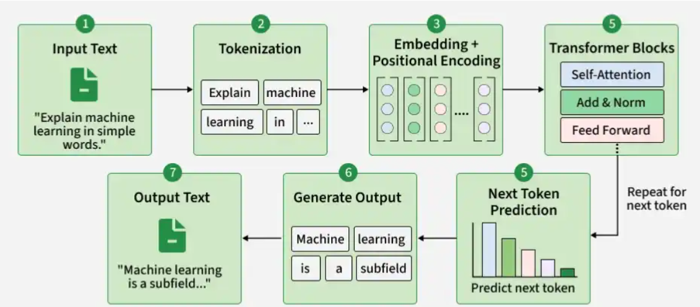

# LLM

## Working of LLM

### Tokenization

The input text is divided into smaller units called tokens.
For example, "Machine learning is useful __" may be split into: ["Machine", " learning", " is", " useful"]

### Embeddings

Each token is converted into a numerical vector called an embedding, which represents its meaning and relationships with other tokens.

### Transformer Architecture

The tokens pass through multiple Transformer blocks that process their relationships using self-attention and feed-forward networks.
A simplified flow is: Tokens → Embeddings → Transformer Blocks → Output

### Self-Attention

Self-attention helps the model understand relationships between tokens by determining which tokens are important to each other.
For example, it helps connect "it" with the relevant word in: The animal crossed the road because it was tired.

### Next-Token Prediction

The LLM predicts the next token based on the previous tokens.
For example, artificial intelligence is → powerful
The process repeats one token at a time until the complete response is generated.