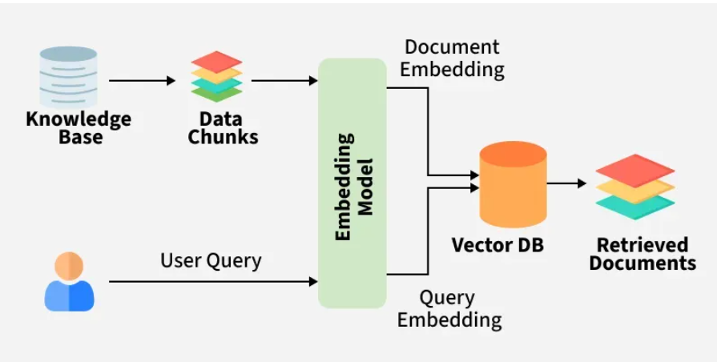

# Retrieval-Augmented Generation (RAG)

Retrieval-Augmented Generation (RAG) is a way to make AI answers more reliable by combining searching for relevant information and then generating a response. Instead of guessing based only on old training data, it first finds useful data from external sources (like documents or databases) and then uses it to give a better answer.

- Fetches up-to-date data and reduces incorrect or made-up answers
- Works well with specialized data like medical or legal content
- No need to retrain the model every time new data comes in
- Can use user-specific data to give more relevant responses

## Components of RAG

The main components of RAG are:

- External Knowledge Source: Stores domain specific or general information like documents, APIs or databases.
- Text Chunking and Preprocessing: Breaks large text into smaller, manageable chunks and cleans it for consistency.
- Embedding Model: Converts text into numerical vectors that capture semantic meaning.
- Vector Database: Stores embeddings and enables similarity search for fast information retrieval.
- Query Encoder: Transforms the user’s query into a vector for comparison with stored embeddings.
- Retriever: Finds and returns the most relevant chunks from the database based on query similarity.
- Prompt Augmentation Layer: Combines retrieved chunks with the user’s query to provide context to the LLM.
- LLM (Generator): Generates a grounded response using both the query and retrieved knowledge.
- Updater (Optional): Regularly refreshes and re-embeds data to keep the knowledge base up to date.

## Working of RAG

The system first searches external sources for relevant information based on the user’s query instead of relying only on existing training data.

- Creating External Data: External data from APIs, databases or documents is chunked, converted into embeddings and stored in a vector database to build a knowledge library.
- Retrieving Relevant Information: User queries are converted into vectors and matched against stored embeddings to fetch the most relevant data ensuring accurate responses.
- Augmenting the LLM Prompt: Retrieved content is added to the user’s query giving the LLM extra context to work with.
- Answer Generation: LLM uses both the query and retrieved data to generate a factually accurate, context aware response.
- Keeping Data Updated: External data and embeddings are refreshed regularly in real time or scheduled so the system always retrieves latest information.

