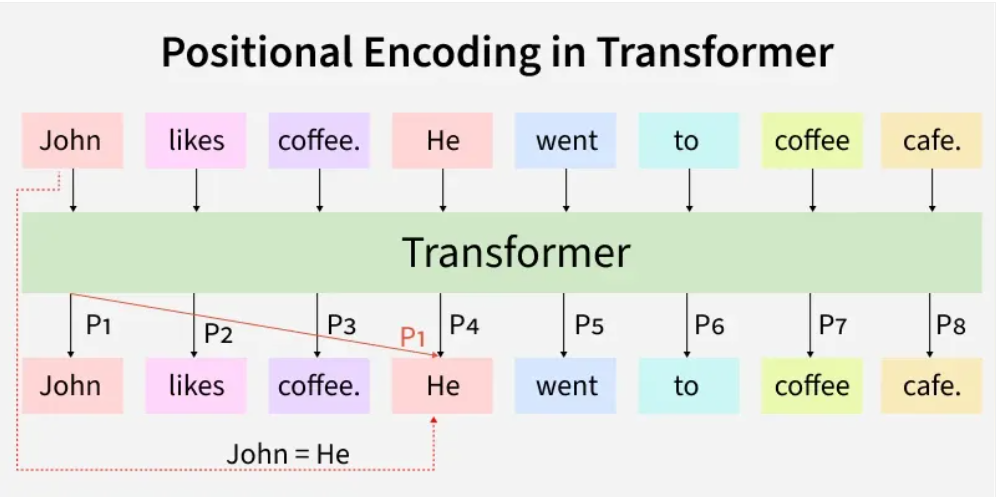

# Transformers

Transformer architecture focuses on understanding relationships within data to process information more effectively.

- Uses attention mechanisms to capture relationships between inputs.
- Processes entire sequences at once instead of step by step.
- Improves performance on tasks involving context and dependencies.

## Need for transformer model

Transformer architecture uses attention to process an entire sentence at once instead of reading words sequentially. This helps overcome limitations of models like RNNs and LSTMs that process data step by step.

Traditional models like RNNs (Recurrent Neural Networks) suffer from the vanishing gradient problem which leads to long-term memory loss.
RNNs process text sequentially meaning they analyze words one at a time.
For example:

- In the sentence: "XYZ went to France in 2019 when there were no cases of COVID and there he met the president of that country" the word "that country" refers to "France".
- However RNNs may struggle to capture long-range dependencies effectively, especially in long sequences, which can make linking distant words more difficult.

While adding more memory cells in LSTMs (Long Short-Term Memory networks) helped address the vanishing gradient issue they still process words one by one. This sequential processing means LSTMs can't analyze an entire sentence at once.

- Traditional Seq2Seq models compress the entire input into a single fixed-size context vector.
- This creates an information bottleneck, especially for long sequences.
- Important context may be lost during compression, reducing performance.
- Transformers solve this by using attention to access all tokens directly without compression.

## Core Concepts of Transformers

### Self attention mechanism

The self attention mechanism allows transformers to determine which words in a sentence are most relevant to each other. This is done using a scaled dot-product attention approach.
Each word in a sequence is mapped to three vectors:

- Query (Q)
- Key (K)
- Value (V)

### Multi-head attention

Instead of one attention mechanism, transformers use multiple attention heads running in parallel. Each head captures different relationships or patterns in the data, enriching the model’s understanding.

### Positional Encoding

Unlike RNNs, transformers lack an inherent understanding of word order since they process data in parallel. To solve this problem Positional Encodings are added to token embeddings providing information about the position of each token within a sequence.

Positional encoding is a technique that adds information about the position of each token in a sequence to its input embedding. This helps transformers understand the order of tokens and capture the structure of a sequence. Without positional information, the self-attention mechanism alone does not inherently know the order of the tokens.

### Position-wise Feed-Forward Networks

The Feed-Forward Networks consist of two linear transformations with a ReLU activation. It is applied independently to each position in the sequence.This transformation helps refine the encoded representation at each position.

### Add & Norm (Residual Connections and Layer Normalization)

Each sub-layer in the transformer (such as self-attention and feed-forward networks) is followed by an Add & Norm step.

- Residual Connection (Add): The input of a layer is added to its output. This helps in preserving information and prevents vanishing gradients in deep networks.
- Layer Normalization (Norm): The combined output is normalized to stabilize training and improve convergence.

This structure ensures better gradient flow and allows training of deep transformer models efficiently.

### Embeddings

Transformers cannot work with raw words as they need numbers. So, each input token (word or subword) is converted into a vector, called an embedding.

- Both encoder input tokens and decoder input tokens are converted into embeddings.
- These embeddings are trainable, meaning the model learns the best numeric representation for each token.
- The same weight matrix is shared for Encoder embeddings, Decoder embeddings and the final linear layer before softmax
- The embeddings are scaled by model to keep values stable before adding positional encoding.

### Encoder-Decoder Architecture

The encoder-decoder structure is key to transformer models. The encoder processes the input sequence into a vector, while the decoder converts this vector back into a sequence. Each encoder and decoder layer includes self-attention and feed-forward layers.

### Softmax Layer for Output Prediction

After the decoder processes the sequence, it must predict the next token.

- The decoder output is passed through a linear layer (whose weights are shared with embeddings).
- Then the softmax function converts these scores into probabilities.
- The token with the highest probability becomes the predicted next word.
