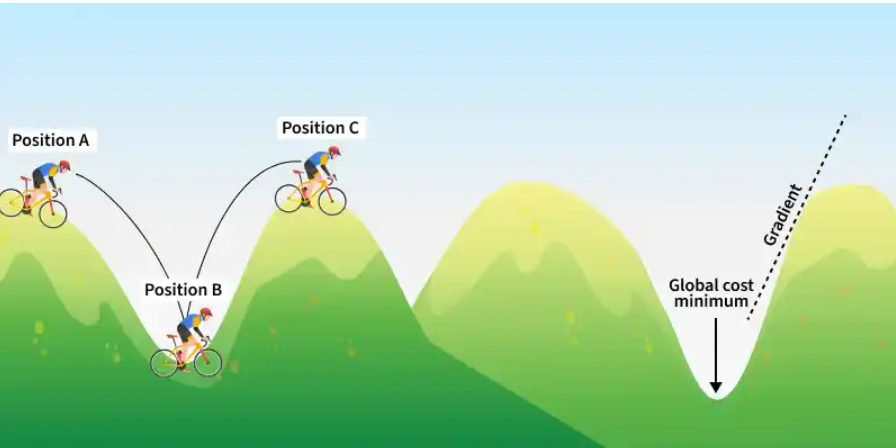
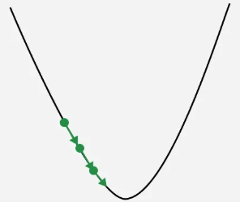
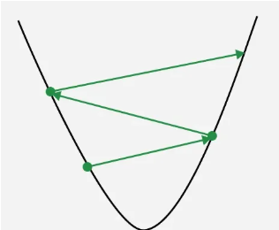

# Gradient Descent

Gradient Descent is an iterative optimization algorithm used to minimize a cost function by adjusting model parameters in the direction of the steepest descent of the function’s gradient. In simple terms, it finds the optimal values of weights and biases by gradually reducing the error between predicted and actual outputs.

Suppose you're at the top of a hill and your goal is to find the lowest point in the valley. You can't see the entire valley from the top, but you can feel the slope under your feet.

- Start at the Top: You begin at the top of the hill (this is like starting with random guesses for the model's parameters).
- Feel the Slope: You look around to find out which direction the ground is sloping down. This is like calculating the gradient, which tells you the steepest way downhill.
- Take a Step Down: Move in the direction where the slope is steepest (this is adjusting the model's parameters). The bigger the slope, the bigger the step you take.
- Repeat: You keep repeating the process feeling the slope and moving downhill until you reach the bottom of the valley (this is when the model has learned and minimized the error).

The key idea is that, just like walking down a hill, Gradient Descent moves towards the "bottom" or minimum of the loss function, which represents the error in predictions.

Moving in opposite direction of the gradient allows the algorithm to gradually descend towards lower values of the function and eventually reaching to the minimum of the function. These gradients guide the updates ensuring convergence towards the optimal parameter values. Gradual steps used in descent is done by defining learning rate.

## Learning Rate

Learning rate is a important hyperparameter in gradient descent that controls how big or small the steps should be when going downwards in gradient for updating models parameters. It is essential to determines how quickly or slowly the algorithm converges toward minimum of cost function.

- If Learning rate is too small: The algorithm will take tiny steps during iteration and converge very slowly. This can significantly increases training time and computational cost especially for large datasets.
- The algorithm may take huge steps leading overshooting the minimum of cost function without settling. It fail to converge causing the algorithm to oscillate. This process is termed as exploding gradient problem.

## Working of Gradient Descent

- Initialize the parameters of the model randomly.
- Compute the gradient of the cost function with respect to each parameter. It involves making partial differentiation of cost function with respect to the parameters.
- Update the parameters of the model by taking steps in the opposite direction of the model. Here we choose a hyperparameter learning rate which is denoted by γ. It helps in deciding the step size of the gradient.
- Repeat steps 2 and 3 iteratively to get the best parameter for the defined model.
