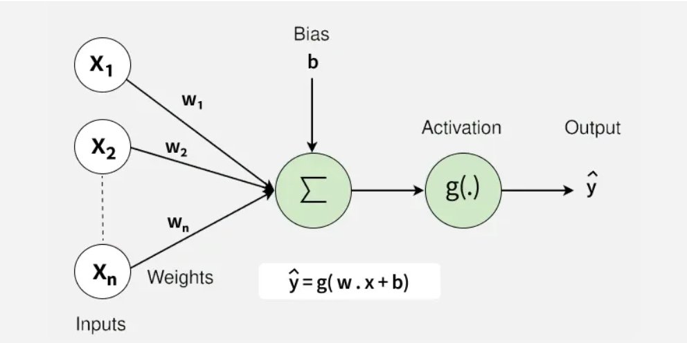
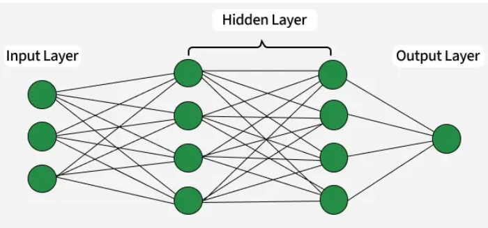
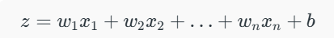

# Neural Networks

Neural Networks are machine learning models inspired by the way the human brain processes information. They consist of interconnected layers of neurons that learn patterns from data and make predictions.

- Learn complex patterns from large datasets.
- Consist of input, hidden, and output layers.
- Used in image recognition, text processing, speech recognition, and prediction tasks.

Neural Networks are built from several key components:

- Neurons: The basic units that receive inputs, each neuron is governed by a threshold and an activation function.
- Connections: Links between neurons that carry information, regulated by weights and biases.
- Weights and Biases: These parameters determine the strength and influence of connections.
- Propagation Functions: Mechanisms that help process and transfer data across layers of neurons.
- Learning Rule: The method that adjusts weights and biases over time to improve accuracy.

Learning in neural networks follows a structured, three-stage process:

- Input Computation: Data is fed into the network.
- Output Generation: Based on the current parameters, the network generates an output.
- Iterative Refinement: The network refines its output by adjusting weights and biases, gradually improving its performance on diverse tasks.

## Layers in Neural Network Architecture

- Input Layer: This is where the network receives its input data. Each input neuron in the layer corresponds to a feature in the input data.
- Hidden Layers: These layers perform most of the computational heavy lifting. A neural network can have one or multiple hidden layers. Each layer consists of units (neurons) that transform the inputs into something that the output layer can use.
- Output Layer: The final layer produces the output of the model. The format of these outputs varies depending on the specific task like classification, regression.

## Working of Neural Networks

### Forward Propagation

When data is input into the network, it passes through the network in the forward direction, from the input layer through the hidden layers to the output layer. This process is known as forward propagation. Here’s what happens during this phase:

#### Linear Transformation

Each neuron in a layer receives inputs which are multiplied by the weights associated with the connections. These products are summed together and a bias is added to the sum. This can be represented mathematically as:

- w represents the weights
- x represents the inputs
- b is the bias

#### Activation

The result of the linear transformation (denoted as z) is then passed through an activation function. The activation function is crucial because it introduces non-linearity into the system, enabling the network to learn more complex patterns. Popular activation functions include ReLU, sigmoid and tanh.

### Backpropagation

After forward propagation, the network evaluates its performance using a loss function which measures the difference between the actual output and the predicted output. The goal of training is to minimize this loss. This is where backpropagation comes into play:

- Loss Calculation: The network calculates the loss which provides a measure of error in the predictions. The loss function could vary; common choices are mean squared error for regression tasks or cross-entropy loss for classification.
- Gradient Calculation: The network computes the gradients of the loss function with respect to each weight and bias in the network. This involves applying the chain rule of calculus to find out how much each part of the output error can be attributed to each weight and bias.
- Weight Update: Once the gradients are calculated, the weights and biases are updated using an optimization algorithm like stochastic gradient descent (SGD). The weights are adjusted in the opposite direction of the gradient to minimize the loss. The size of the step taken in each update is determined by the learning rate.

### Iteration

This process of forward propagation, loss calculation, backpropagation and weight update is repeated for many iterations over the dataset. Over time, this iterative process reduces the loss and the network's predictions become more accurate.
