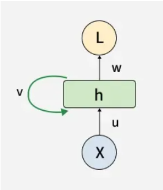
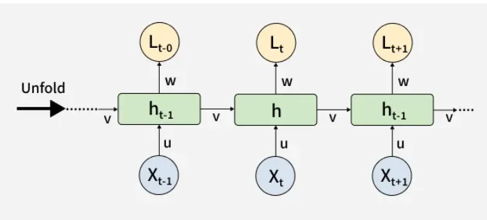

# Recurrent Neural Networks (RNN)

Recurrent Neural Networks (RNNs) are a class of neural networks designed to process sequential data by retaining information from previous steps. They are especially effective for tasks where context and order matter.

- Designed for sequential and temporal data.
- Maintains memory of past inputs.
- Widely used in NLP, forecasting and speech tasks.

Imagine reading a sentence and you try to predict the next word, you don’t rely only on the current word but also remember the words that came before. RNNs work similarly by “remembering” past information i.e it considers all the earlier words to choose the most likely next word.

## Key Components of RNNs

### Recurrent Neurons

The fundamental processing unit in RNN is a Recurrent Unit. They hold a hidden state that maintains information about previous inputs in a sequence. Recurrent units can "remember" information from prior steps by feeding back their hidden state, allowing them to capture dependencies across time.

### RNN Unfolding

RNN unfolding or unrolling is the process of expanding the recurrent structure over time steps. During unfolding each step of the sequence is represented as a separate layer in a series illustrating how information flows across each time step.

This unrolling enables backpropagation through time (BPTT) a learning process where errors are propagated across time steps to adjust the network’s weights enhancing the RNN’s ability to learn dependencies within sequential data.

