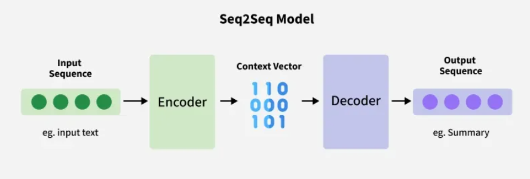

# Sequence‑to‑Sequence (Seq2Seq)

Sequence‑to‑Sequence (Seq2Seq) models are neural networks designed to transform one sequence into another, even when the input and output lengths differ and are built using encoder‑decoder architecture.

Both the input and the output are treated as sequences of varying lengths and the model is composed of two parts:

## Encoder

- Processes the input sequence token by token.
- Encodes the entire sequence into a fixed-length context vector (or a series of hidden states) that summarizes the important information from the input.

## Decoder

- Takes the context vector as input.
- Generates the output sequence one token at a time, predicting each token based on the context vector and previously generated tokens.

The model is commonly used in tasks where there is a need to map sequences of varying lengths such as converting a sentence in one language to another or predicting a sequence of future events based on past data i.e time-series forecasting.
